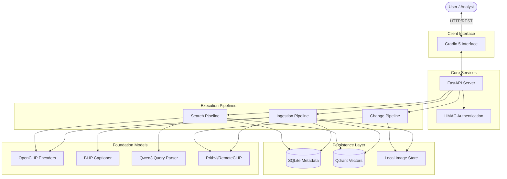
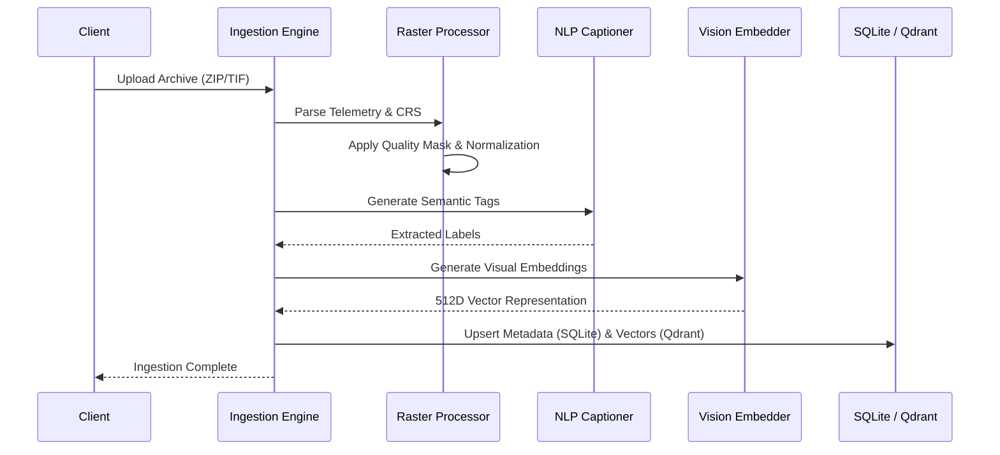
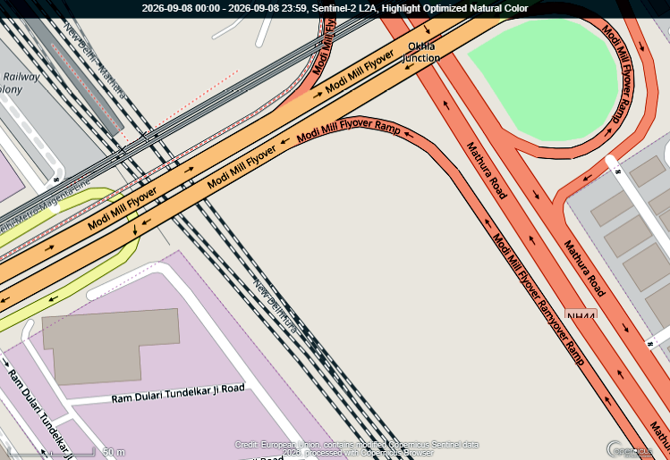

# GeoSearch AI

**Earth Observation Semantic Search & Temporal Change Detection**


---

## 1. Abstract

**GeoSearch AI** is a multimodal search and analysis engine designed for intelligence analysts, researchers, and geospatial professionals. It transcends traditional metadata-based querying by enabling **Natural Language Semantic Search** and **Image-to-Image similarity mapping** across large-scale remote sensing archives.

Built with a strict **Offline-First** architecture, the system guarantees that sensitive telemetry and imagery never leave the local environment, executing foundation models (OpenCLIP, Qwen3, BLIP, Prithvi) entirely on edge or isolated hardware.

---

## 2. Core Capabilities

* **Multimodal Semantic Search:** Query satellite imagery using natural language (e.g., *"Show me industrial facilities near water bodies"*).
* **Automated Change Detection:** Perform temporal analysis between historical and current scenes to identify infrastructural or environmental deviations.
* **Offline-First Execution:** Fully operational in air-gapped environments. All models are staged and executed locally.
* **Multi-Signal Ranking Algorithm:** A sophisticated scoring engine that blends Cosine Similarity from vector embeddings with lexical keyword boosts and quality metric penalties (e.g., cloud cover) for high-precision retrieval.
* **Automated Metadata Extraction:** Ingestion pipelines automatically generate captions and semantic tags for unlabeled imagery.

---

## 3. Application Interface

### Website Overview


### AI Processing Pipeline


---

## 4. Architecture & Processing Pipelines

GeoSearch AI utilizes a highly modular pipeline-driven architecture. 

### 4.1 System Topology



### 4.2 Ingestion & Semantic Tagging
During the ingestion of raster data (GeoTIFF, Sentinel, Landsat), the system normalizes the data, applies cloud-masking, and extracts latent features.



---

## 5. Sample Data & Results

### 5.1 Processed Imagery Sample
*Sample Sentinel-2 imagery successfully ingested, normalized, and semantically tagged by the engine:*



### 5.2 Application Interface Screenshots

**Semantic Search UI:**


**Temporal Change Detection:**


---

## 6. Local Setup & Installation

### Prerequisites
* **Operating System:** Windows, Linux, or macOS
* **Python:** 3.11 – 3.13
* **Hardware:** 16GB+ RAM (GPU recommended for staging and inference)

### Initialization

1. **Clone the Repository and Configure Environment:**
```bash
git clone https://github.com/your-org/geosearch-ai.git
cd geosearch-ai

python -m venv .venv
# Windows: .venv\Scripts\activate
# Linux/Mac: source .venv/bin/activate

pip install -r requirements.txt
```

2. **Stage Foundation Models (Offline Preparation):**
The system requires foundation models to be downloaded to local storage before executing in an air-gapped environment.
```bash
python scripts/stage_models.py
```
*(This fetches OpenCLIP, BLIP, Qwen3, and RemoteCLIP to `data/models/`)*

3. **Start the Application Server:**
```bash
python run_server.py
```

* **Web UI:** `http://127.0.0.1:7860`
* **REST API Specs:** `http://127.0.0.1:7860/api/docs`

---

## 7. Production Deployment (Hugging Face Spaces)

GeoSearch AI can be deployed to remote infrastructure such as Hugging Face Spaces using the **Docker SDK**.

1. **Hardware Configuration:** Requires a minimum of **T4 Small GPU** (A10G recommended).
2. **Persistent Storage:** Attach a Persistent Volume for `sqlite` and `qdrant` to maintain state across container restarts.
3. **Model Management:** Commit large models to a private HF Dataset repository using `git lfs`, and configure the Docker `CMD` to execute `snapshot_download` on boot.
4. **Environment Variables:**
   * `HF_HUB_OFFLINE=1`
   * `TRANSFORMERS_OFFLINE=1`
   * `SECRET_KEY=[secure_hmac_token]`

*(Refer to `huggingface_deployment.md` for a comprehensive step-by-step CI/CD guide).*
