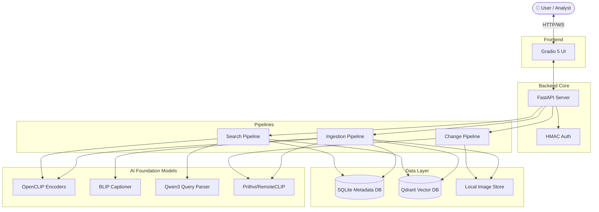
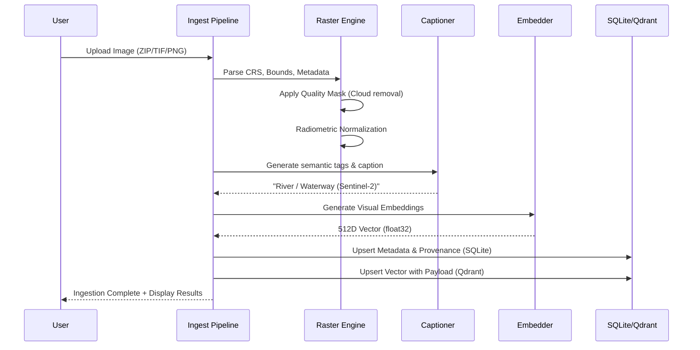

<div align="center">
  
  <br/>
  <h1>🌍 GeoSearch AI</h1>
  <p><strong>Earth Observation Semantic Search & Temporal Change Detection AI</strong></p>

  <p>
    
    
    
    
    
  </p>
</div>

---

## 📖 Table of Contents
1. [🌟 Overview](#-overview)
2. [✨ Key Features](#-key-features)
3. [📸 Showcase & Results](#-showcase--results)
4. [🧠 Core Technologies & Models](#-core-technologies--models)
5. [🏗️ In-Depth Architecture](#️-in-depth-architecture)
   - [System Topology](#1-system-topology)
   - [Ingestion Pipeline](#2-ingestion-pipeline)
   - [Search & Retrieval Pipeline](#3-search--retrieval-pipeline)
6. [🚀 Installation & Setup](#-installation--setup)
7. [💻 Usage](#-usage)
8. [☁️ Deployment (Hugging Face)](#️-deployment-hugging-face)

---

## 🌟 Overview

**GeoSearch AI** is a state-of-the-art, multimodal search and analysis engine designed for remote sensing and satellite imagery. It breaks away from traditional metadata-only queries (like searching purely by date or bounding box) by enabling **Natural Language Semantic Search** and **Image-to-Image similarity mapping**. 

Designed for intelligence analysts, researchers, and geospatial professionals, the system is strictly **Offline-First**, ensuring sensitive data never leaves the local environment while leveraging powerful foundation models (CLIP, Qwen3, Prithvi) on edge hardware.

---

## ✨ Key Features

- 🗣️ **Natural Language Spatial Search:** Search vast imagery archives using plain English (e.g., *"Show me industrial facilities near water bodies"*).
- 🖼️ **Image-to-Image Matching:** Upload a reference image to instantly find visually and semantically similar scenes across your dataset.
- ⏳ **Automated Change Detection:** Compare historical and current scenes to automatically detect urban expansion, deforestation, or infrastructural changes.
- 🔒 **100% Offline-First:** Fully functional without internet access. Models are downloaded and staged locally.
- ⚡ **Multi-Signal Ranking:** Blends deep vector embeddings (Cosine Similarity) with lexical keyword boosts and quality metrics (cloud cover penalties) for pinpoint accuracy.
- 🎨 **Modern UI:** Built on **Gradio 5**, offering a sleek, responsive, and highly interactive visual interface.

---

## 📸 Showcase & Results

*(Replace the placeholder images below with actual screenshots of the application running)*

### 🔍 1. Semantic Search Interface
Search for complex geographical features using text. The UI returns deeply detailed cards with metadata, sensor stats, and confidence scores.
<p align="center">
  
</p>

### 🔄 2. Temporal Change Detection
Highlight structural and natural changes over time by selecting a baseline and a recent scene. 
<p align="center">
  
</p>

### 📊 3. Automated Image Captioning & Tagging
Upon ingestion, scenes are automatically tagged (e.g., `AnnualCrop`, `River`, `Industrial`) and captioned using BLIP.
<p align="center">
  
</p>

---

## 🧠 Core Technologies & Models

| Component | Technology / Model | Purpose |
| :--- | :--- | :--- |
| **Frontend UI** | `Gradio 5.x` | Interactive, reactive user interface for ML workflows. |
| **Backend API** | `FastAPI` + `Uvicorn` | High-performance async REST API and server orchestration. |
| **Vector DB** | `Qdrant` | High-speed, persistent similarity search for multimodal embeddings. |
| **Metadata DB** | `SQLite` (`SQLAlchemy`) | Relational storage for geospatial metadata, provenance, and telemetry. |
| **Semantic NLP** | `Qwen3` (0.6B/1.7B) | Local NLP engine for parsing complex spatial-temporal queries. |
| **Vision/Text** | `OpenCLIP` | Shared embedding space for text-to-image and image-to-image search. |
| **Captioning** | `BLIP` | Automated scene description and tag generation upon ingestion. |
| **Geospatial** | `Prithvi` / `RemoteCLIP`| Specialized foundation models for remote sensing data. |

---

## 🏗️ In-Depth Architecture

GeoSearch AI employs a modular, pipeline-driven architecture to ensure scalability and reliability.

### 1. System Topology



### 2. Ingestion Pipeline
When a ZIP folder, directory, or individual imagery file (Sentinel-2, Landsat, GeoTIFF, etc.) is dropped into the engine:



### 3. Search & Retrieval Pipeline
Search utilizes a sophisticated **Multi-Signal Ranking Algorithm** that prevents exact keyword matches from destroying semantic meaning, blending both gracefully.

```mermaid
flowchart LR
    Q["Query: 'Show me industrial factories'"] --> P[Qwen3 Query Parser]
    
    P --> |Temporal Constraints| Filter[Metadata Filters (Dates, BBox)]
    P --> |Semantic Intent| Embed[CLIP Text Encoder]
    
    Embed --> |512D Vector| ANN[Qdrant ANN Search]
    Filter --> ANN
    
    ANN --> |Raw Candidates| Rerank[Reranker / Scorer]
    
    Q --> |Regex Keywords| Lex[Lexical Matcher (SQLite)]
    Lex --> |Boost Score: +0.15 * Lex| Rerank
    
    Rerank --> |Scene Dedup & Combined Score| Format[Card Formatter]
    Format --> UI[Gradio UI]
```
> **Algorithmic Note:** Final Similarity = `(0.80 * Cosine_Sim) + (0.10 * Quality_Score) + Feedback_Bias + (0.15 * Lexical_Boost)`.

---

## 🚀 Installation & Setup

### 1. Prerequisites
- **OS:** Windows / Linux / macOS
- **Python:** 3.11 – 3.13
- **Hardware:** 16GB+ RAM. (GPU highly recommended for model staging & inference).

### 2. Clone & Environment Setup
```bash
git clone https://github.com/your-org/geosearch-ai.git
cd geosearch-ai

# Create virtual environment
python -m venv .venv

# Activate (Windows)
.venv\Scripts\activate
# Activate (Linux/Mac)
source .venv/bin/activate

# Install dependencies
pip install -r requirements.txt
```

### 3. Stage the Offline Models
Because the system runs offline, you must download the models once while connected to the internet:
```bash
python scripts/stage_models.py
```
*This will download OpenCLIP, BLIP, Qwen3, and other necessary assets to `data/models/` (approx 3-5 GB).*

---

## 💻 Usage

Start the main server:

```bash
python run_server.py
```

You should see a beautiful CLI boot sequence confirming all models are `[READY]` and the databases are connected.

- **Web UI:** Navigate to `http://127.0.0.1:7860` in your browser.
- **REST API:** Navigate to `http://127.0.0.1:7860/api/docs` for the Swagger documentation.

---

## ☁️ Deployment (Hugging Face)

GeoSearch AI is production-ready for **Hugging Face Spaces (Docker SDK)**. 

1. **Hardware:** Requires **T4 Small GPU** or **A10G**.
2. **Storage:** Requires HF Persistent Storage for `sqlite` and `qdrant` state persistence.
3. **Setup:** 
   - Upload the heavy models (`data/models/`) to a private HF Dataset repository using `git lfs`.
   - Modify the `Dockerfile` `CMD` to run a script that calls `huggingface_hub.snapshot_download` to pull the models to the container on boot.
   - Set environment variables `HF_HUB_OFFLINE=1` and `TRANSFORMERS_OFFLINE=1`.

*(For a step-by-step guide on deployment, view `huggingface_deployment.md` included in this repository).*

---

<p align="center">
  <br/>
  <i>Built with ❤️ for the Earth Observation & Open Source Community.</i>
</p>
