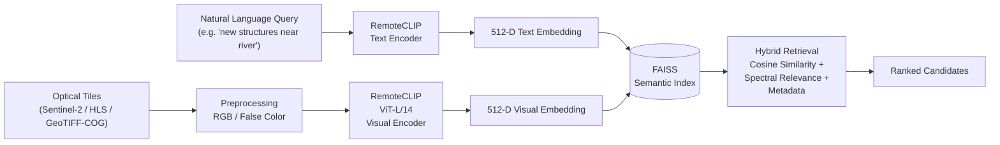
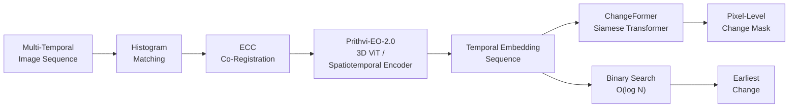
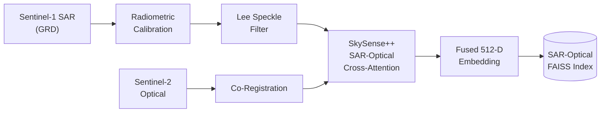
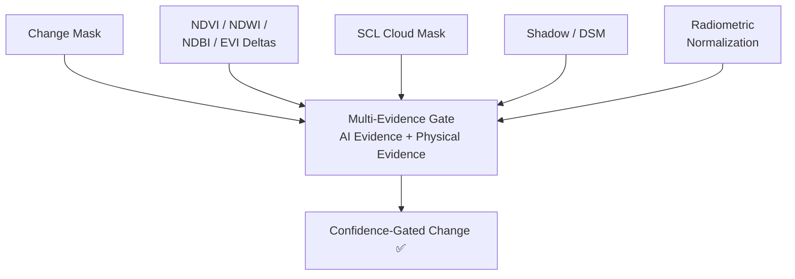
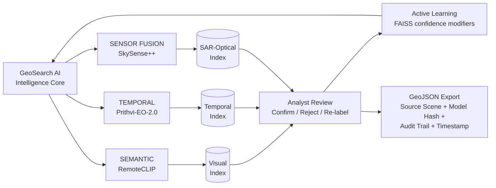

# GeoSearch AI

**Earth Observation Semantic Search & Temporal Change Detection**

---

## Technology Stack

### Languages


### Frontend


### Backend + AI


### Search + Geo


### Data + Storage


---

## 1. Abstract

**GeoSearch AI** is a multimodal search and analysis engine designed for intelligence analysts, researchers, and geospatial professionals. It transcends traditional metadata-based querying by enabling **Natural Language Semantic Search** and **Image-to-Image similarity mapping** across large-scale remote sensing archives.

Built with a strict **Offline-First** architecture, the system guarantees that sensitive telemetry and imagery never leave the local environment, executing foundation models (RemoteCLIP, Prithvi-EO-2.0, SkySense++, ChangeFormer) entirely on edge or isolated hardware.

---

## 2. Core Capabilities

* **Multimodal Semantic Search:** Query satellite imagery using natural language (e.g., *"Show me industrial facilities near water bodies"*).
* **Automated Change Detection:** Perform temporal analysis between historical and current scenes using ChangeFormer to identify infrastructural or environmental deviations.
* **Offline-First Execution:** Fully operational in air-gapped environments. All models are staged and executed locally.
* **Multi-Signal Ranking Algorithm:** A sophisticated scoring engine that blends Cosine Similarity from FAISS vector search with lexical keyword boosts and quality metric penalties (e.g., cloud cover) for high-precision retrieval.
* **Geospatial Clustering:** HDBSCAN + UMAP for spatial pattern discovery across large archives.
* **Automated Metadata Extraction:** Ingestion pipelines automatically generate captions and semantic tags for unlabeled imagery.

---

## 3. Application Interface

### Website Overview


### AI Processing Pipeline


---

## 4. Architecture & Processing Pipelines

GeoSearch AI is built around four intelligence modules that operate on Earth Observation inputs (Sentinel-2/HLS optical, Sentinel-1 SAR GRD, and multi-date temporal archives) and deliver structured analyst outputs.

---

### 4.1 Module 1 — Semantic Intelligence *(Optical + Text)*

Natural language queries and optical tiles are independently encoded by **RemoteCLIP ViT-L/14** into a shared 512-D embedding space. A **FAISS Semantic Index** performs hybrid retrieval combining Cosine Similarity, spectral relevance, and metadata filters to return ranked image candidates.



---

### 4.2 Module 2 — Temporal Intelligence *(Multi-Temporal Analysis)*

Multi-temporal image sequences are co-registered via **ECC + Histogram Matching**, then encoded by **Prithvi-EO-2.0** (3D ViT Spatiotemporal Encoder) into temporal embedding sequences. Two parallel heads then operate:

- **ChangeFormer** (Siamese Transformer) → pixel-level change mask
- **Binary Search O(log N)** → earliest change detection with temporal onset



---

### 4.3 Module 3 — Multi-Sensor Fusion *(SAR + Optical)*

Sentinel-1 SAR data undergoes radiometric calibration and Lee Speckle filtering. It is then fused with co-registered Sentinel-2 optical data via **SkySense++** (SAR-Optical Cross-Attention), producing a fused 512-D embedding stored in a dedicated **SAR-Optical FAISS Index**.



---

### 4.4 Module 4 — False-Alarm / Evidence Layer

Before a change is confirmed, a **Multi-Evidence Gate** validates it against multiple physical signals to suppress false alarms:

| Evidence Signal | Purpose |
|---|---|
| Change Mask | Primary ChangeFormer output |
| NDVI / NDWI / NDBI / EVI Deltas | Vegetation, water, built-up, vegetation index changes |
| SCL Cloud Mask | Suppress cloud-induced artifacts |
| Shadow / DSM | Terrain and shadow interference filtering |
| Radiometric Normalization | Cross-date illumination correction |

Only detections passing all gates are emitted as **Confidence-Gated Changes**.



---

### 4.5 Intelligence Core & Active Learning

All three FAISS indexes (Visual, Temporal, SAR-Optical) are managed by the **GeoSearch AI Intelligence Core**. Analyst feedback (Confirm / Reject / Re-label) flows into an **Active Learning** loop that adjusts FAISS confidence modifiers — with no foundation-model retraining required.



---

## 5. Local Setup & Installation

### Prerequisites
* **OS:** Windows, Linux, or macOS
* **Python:** 3.11 – 3.13
* **Node.js:** 18+
* **Hardware:** 16 GB+ RAM (GPU recommended for model inference)

### Backend Setup

```bash
git clone https://github.com/your-org/geosearch-ai.git
cd geosearch-ai

python -m venv .venv
# Windows: .venv\Scripts\activate
# Linux/Mac: source .venv/bin/activate

pip install -r requirements.txt
```

### Frontend Setup

```bash
cd frontend
npm install
npm run dev
```

### Stage Foundation Models

```bash
python scripts/stage_models.py
```

*Downloads RemoteCLIP, Prithvi-EO-2.0, SkySense++, and ChangeFormer to `data/models/`*

### Start the API Server

```bash
python run_server.py
```

* **Web UI:** `http://127.0.0.1:5173`
* **REST API Docs:** `http://127.0.0.1:8000/docs`

---

## 6. Production Deployment (Hugging Face Spaces)

GeoSearch AI can be deployed to Hugging Face Spaces using the **Docker SDK**.

1. **Hardware:** Minimum **T4 Small GPU** (A10G recommended)
2. **Persistent Storage:** Attach a Persistent Volume for `sqlite` and FAISS indexes
3. **Model Management:** Commit large models to a private HF Dataset repo via `git lfs`; configure Docker `CMD` to run `snapshot_download` on boot
4. **Environment Variables:**
   * `HF_HUB_OFFLINE=1`
   * `TRANSFORMERS_OFFLINE=1`
   * `SECRET_KEY=[secure_hmac_token]`

*Refer to `huggingface_deployment.md` for the full CI/CD guide.*
