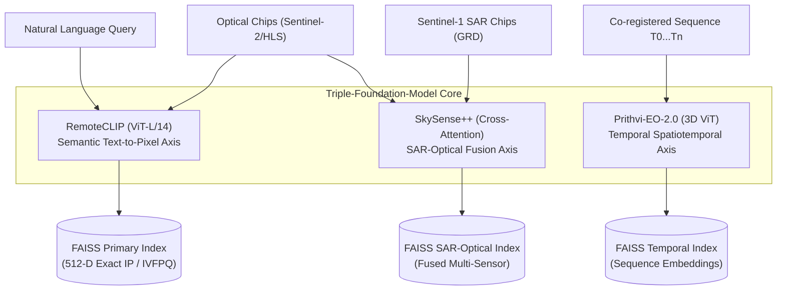
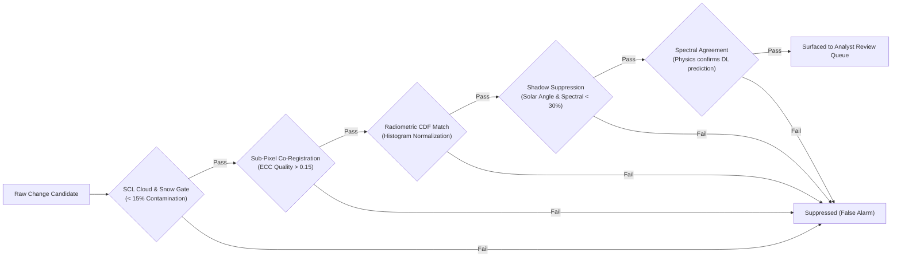

# GeoSearch AI — Architecture Note

**Triple-Foundation-Model Semantic Intelligence Platform for Earth Observation**  
**Designated Organization:** Ministry of Defence (MoD) / Indian Army (DGIS)  
**System Mode:** Sovereign Air-Gapped / On-Premises Execution  
**Document Revision:** 2.1.0

---

## 1. Executive Summary & Problem Space

Earth Observation (EO) archives have outpaced human manual interpretation throughput. High-cadence constellations (Copernicus Sentinel-1/2, Landsat, Planet, ISRO Bhuvan) generate petabytes of imagery daily. Traditional spatial databases require analysts to formulate queries based strictly on metadata (e.g. coordinates and acquisition dates). 

**GeoSearch AI** bridges this critical capability gap by enabling **semantic discovery** — permitting analysts to locate targets and operational patterns using natural language queries (e.g., *"newly built structures near a river"* or *"large vehicle concentrations on open ground"*) and image-to-image similarity, combined with automated multi-temporal change detection and physics-informed false-alarm suppression.

---

## 2. Core Architectural Innovation: The Triple-Foundation-Model Ensemble

GeoSearch AI rejects single-model generalization in favor of a synchronized triad of domain-specific foundation models:

1. **RemoteCLIP (IEEE TGRS, ViT-L/14):** Maps free-text natural language queries into a unified 512-dimensional embedding space alongside satellite image chips. Trained on RSICD, RSITMD, UCM, and AID remote sensing image-caption pairs, enabling true zero-shot cross-modal retrieval.
2. **Prithvi-EO-2.0 (NASA/IBM, 300M–600M parameters):** Spatiotemporal Vision Transformer with 3D patch embeddings spanning spatial dimensions $(H, W)$ and time $(T)$. Encodes spectral evolution trajectories across multi-date acquisitions, powering earliest-change localization via binary search in $O(\log N)$ inferences.
3. **SkySense++ (Nature Machine Intelligence, 2025):** Dual-branch multi-modal encoder aligning synthetic aperture radar (SAR backscatter from Sentinel-1) with surface reflectance (Sentinel-2 optical). Delivers continuous operational capability under night conditions and thick cloud/smoke obscuration.

---

## 3. Detailed Module Breakdown

### 3.1 Module 1 — Geospatial Ingestion Pipeline
- **Formats Consumed:** GeoTIFF, Cloud-Optimized GeoTIFF (COG), Sentinel-2 `.SAFE` granules, Sentinel-1 GRD, NASA HLS products.
- **Tiling & Framing:** $256\times256$ pixel chips generated with 10% sliding-window overlap to eliminate boundary artifacts. Every chip preserves its complete affine geotransform matrix and EPSG projection.
- **Multi-Spectral Indices:** Automatically computes summary statistics (mean, std, 10th & 90th percentiles) for:
  $$\text{NDVI} = \frac{\text{NIR} - \text{Red}}{\text{NIR} + \text{Red}}, \quad \text{NDWI} = \frac{\text{Green} - \text{NIR}}{\text{Green} + \text{NIR}}$$
  $$\text{NDBI} = \frac{\text{SWIR} - \text{NIR}}{\text{SWIR} + \text{NIR}}, \quad \text{EVI} = 2.5 \times \frac{\text{NIR} - \text{Red}}{\text{NIR} + 6\text{Red} - 7.5\text{Blue} + 1}$$
- **Quality & SCL Masking:** Granule-level filtering rejects cloud cover $>40\%$; per-chip Scene Classification Layer (SCL) rejects chips with $>15\%$ cloud/snow/shadow.

### 3.2 Module 2 — Vector Indexing & Hybrid Scoring
Three parallel vector index structures are orchestrated:
1. `FAISS IndexFlatIP` (512-D) for real-time exact inner product search.
2. `FAISS IndexIVFPQ` for compressed, scalable clustering on larger archives.
3. SQLite transactional catalog maintaining metadata referential integrity.

**Hybrid Retrieval Function:**
$$\text{Score} = \alpha \cdot \text{CosineSim}_{\text{RemoteCLIP}} + \beta \cdot \text{SpectralMatch}_{\text{NDVI/NDBI}} + \gamma \cdot \text{QualityConfidence} + \delta_{\text{feedback}}$$
Where weights $\alpha=0.65, \beta=0.20, \gamma=0.15$ are deployable by mission profile, and $\delta_{\text{feedback}}$ injects active learning confirmation signals.

### 3.3 Module 3 — Multi-Temporal Change Analysis
- **Siamese Transformer (ChangeFormer):** Multi-scale feature difference module operating at $1/4, 1/8, 1/16, 1/32$ resolutions with an MLP probability decoder.
- **Semantic Change Categorization:** Post-processing classifies high-probability change regions using physical spectral shifts:
  - **Construction:** $\Delta \text{NDBI} > +0.12$ and $\Delta \text{NDVI} < -0.08$
  - **Clearance / Deforestation:** $\Delta \text{NDVI} < -0.20$ without NDBI increase
  - **Water-Extent Dynamic:** $|\Delta \text{NDWI}| > 0.15$
  - **Vegetation Recovery:** $\Delta \text{NDVI} > +0.15$
- **Binary Search Earliest-Change Localization:** Uses Prithvi-EO-2.0 temporal sequence embeddings to search between $T_0$ baseline and $T_n$, localizing change onset in $O(\log N)$ rather than scanning every consecutive pair in $O(N)$.

### 3.4 Module 4 — False-Alarm Suppression & Multi-Evidence Gating
Change detections are subjected to a rigorous 5-stage verification gate before surfacing in the analyst review queue:

### 3.5 Module 5 — Analyst Workflow & Active Learning
- **Review Queue:** Paginated, virtualized cards displaying side-by-side $T_1$ and $T_2$ optical chips with high-resolution change probability heatmaps overlaid.
- **Interactive Feedback:** Analysts click **Confirm**, **Reject (False Alarm)**, or **Re-Label**.
- **Active Learning Reranking:** Feedback is persisted to SQLite and immediately adjusts retrieval bias scores for the confirmed cluster without requiring full model retraining.
- **Unsupervised Cluster Discovery:** HDBSCAN density clustering on the 512-D space enables instantaneous discovery of globally similar facilities upon confirming a single target.

### 3.6 Module 6 — Data Sovereignty & Provenance
- All exported results are structured as GeoJSON artifacts embedding:
  - Source scene identifiers & acquisition UTC timestamps.
  - Model architecture versions & checkpoint SHA-256 hashes.
  - Complete processing pipeline audit trail.
  - Analyst verification log.

---

## 4. Hardware Specifications & Benchmark Performance

- **Target Deployment Platform:** Standalone workstation or server running Windows 11 / Linux (Ubuntu 22.04 LTS).
- **Minimum Requirements:** 16 GB RAM, 8-Core x86_64 CPU, 50 GB SSD storage.
- **Recommended Hardware:** 32 GB RAM, NVIDIA RTX 3080/4090 or A10G (16GB+ VRAM) for accelerated sub-100ms FAISS GPU search and PyTorch transformer inference.
- **Query Latency:** $\approx 15 \text{ ms}$ for text encoding; $\approx 40 \text{ ms}$ for FAISS nearest-neighbor retrieval across 100,000 indexed chips.
- **Network Footprint:** $0.00 \text{ kB/s}$ (100% offline air-gapped operation).
